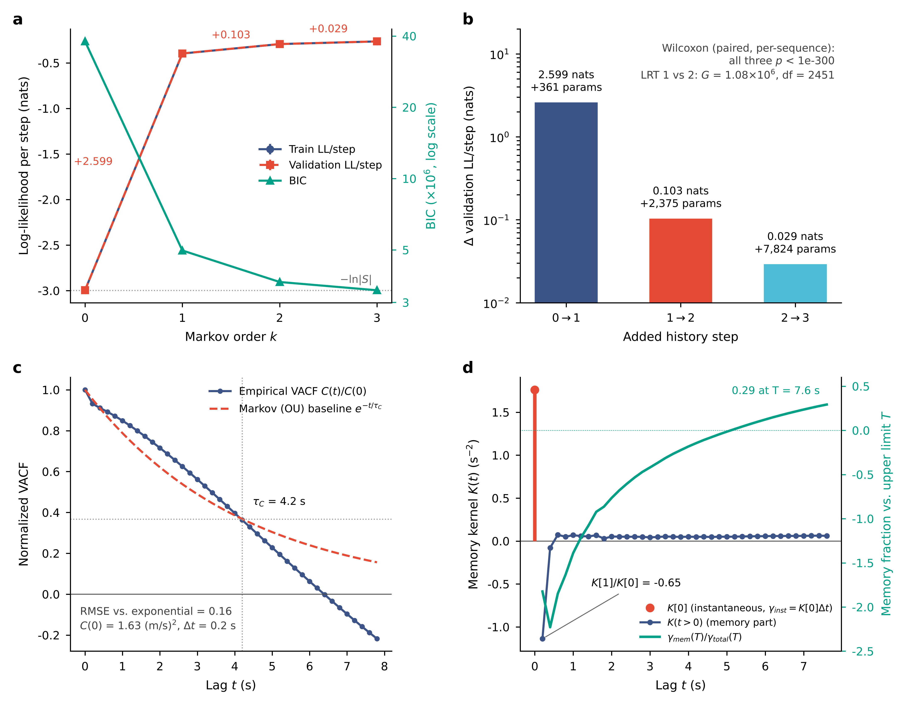
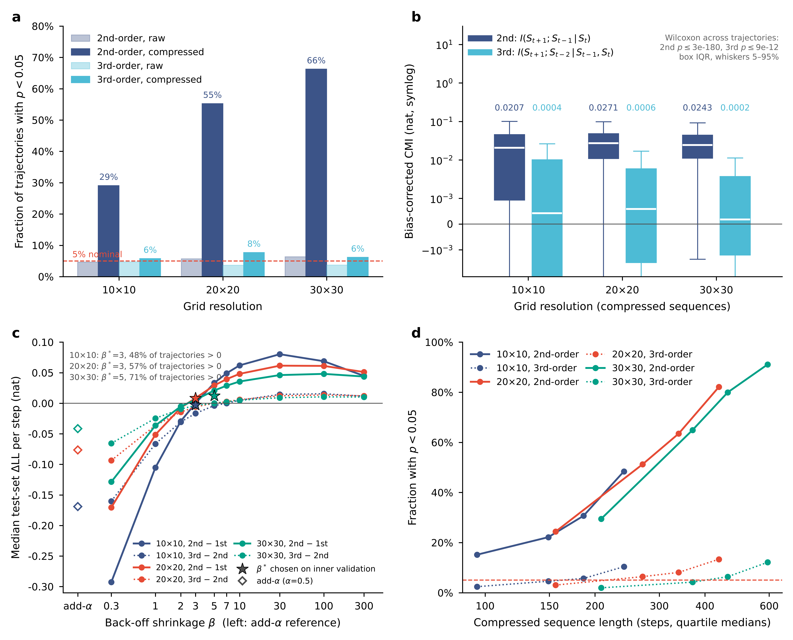
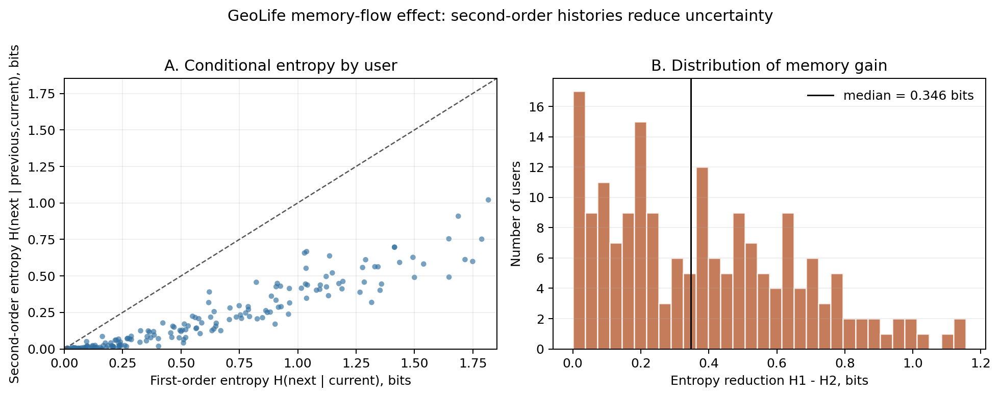

<div align="center">

# 交通流中的记忆效应

**量化车辆、旅客与 GPS 轨迹的下一步在多大程度上依赖于"当前状态之外"的历史**

[English](README.md) | [简体中文](README_zh.md)

[](https://www.python.org/)
[](LICENSE)
[](#-快速开始)
[](#-数据集)
[](#-引用)

</div>

---

## 📖 项目简介

绝大多数交通流与移动性模型都是一阶马尔可夫的：下一状态只依赖当前状态。本仓库在四个截然不同的移动性数据集上回答同一个问题——**当前状态之外的历史是否携带信息？携带多少？这些信息能否真正转化为预测收益？**

我们使用一套统一的工具：

| 工具 | 度量对象 | 应用数据集 |
|---|---|---|
| 马尔可夫阶数比较（样本外对数似然 / 困惑度 / BIC） | 二阶、三阶链相对一阶链的预测收益 | highD、出租车、GeoLife（可选）、机场 |
| 条件互信息 `I(S_{t+1}; S_{t-1} \| S_t)` + 分层置换零分布 | 二阶记忆的信息论**上限** | 出租车 |
| 熵减 `H(next \| current) − H(next \| prev, current)` | 一阶流表示所隐藏的记忆 | GeoLife |
| 速度自相关 + 广义朗之万记忆核 | 速度长记忆的形状与幂律衰减 | highD、GeoLife（按交通方式） |
| 桑基图回流分析、RNN 与 LSTM 对比 | O-D 路径中"返回出发地"的定性记忆 | 机场（BTS DB1B） |

仓库按**每个数据集一个自包含文件夹**组织。每个文件夹要么几秒钟内从缓存结果端到端复现，要么通过一个开关从原始数据完整重算。

---

## ✨ 特点

- 🧪 **四个数据集，一个问题** —— 高速公路车辆（highD）、上海出租车（SUVnet GPS）、182 位 GeoLife 用户、51.1 万条 BTS 航空 O-D 路径。
- 📓 **Notebook 优先、缓存优先** —— highD 与出租车分析各是一份 notebook，每一步都写明*为什么做、预期什么、如何解读*；`RUN_COMPUTE = False` 时几秒钟内由随仓库发布的 CSV/NPZ 缓存复现全部表格与图。
- 🎨 **可直接投稿的图** —— Nature 配色的多面板图（600 dpi `.png` + `.pdf`），由 notebook 自动生成。
- 🔍 **诚实的估计量分析** —— 我们证明出租车数据上二阶收益的*符号*取决于平滑估计量（add-α 与 back-off β），并在训练段内部验证集上调 β；信息论上限（CMI）与实际实现的收益并列报告。
- 🧹 **只保留论文用到的代码** —— 每个脚本都对应论文中的某张表或图；废弃实验、重复脚本和机器相关的绝对路径都已清除，原始数据放在 git 忽略的 `data/` 目录，附下载说明。

---

## 📊 主要结果

<details open>
<summary><b>highD —— 高速公路车辆速度（60 段录像，0.2 s 步长，20 个速度状态）</b></summary>

| 阶数 k | 样本外 LL / step (nat) | 困惑度 | 相对 k−1 的收益 |
|---|---|---|---|
| 0 | −2.995 | 19.99 | – |
| 1 | −0.397 | 1.487 | – |
| 2 | **−0.293** | **1.341** | +0.103 nat = `H(S_{t+1}\|S_t)` 的 **26 %** |
| 3 | −0.264 | 1.302 | +0.029 nat |

LRT（2 vs 1）：G = 1.08 × 10⁶，770 万步，p ≈ 0。VACF 非指数衰减，离散 GLE 核 `K[1]/K[0] = −0.65`；早期的"记忆占比 29 %"因随积分窗口变号而**不再报告**。

<p align="center"></p>
</details>

<details open>
<summary><b>上海出租车 —— GPS 网格（4 307 条轨迹，10×10 / 20×20 / 30×30 网格）</b></summary>

| 网格 | CMI₂ 中位数 (nat) | CMI₂ 显著轨迹比例 | ΔLL(2 vs 1)，add-α | ΔLL(2 vs 1)，调参 back-off β* | 二阶占优比例 |
|---|---|---|---|---|---|
| 10×10 | 0.021 | 29 % | −0.169 | −0.003（均值 +0.015） | 48 % |
| 20×20 | 0.027 | 55 % | −0.076 | **+0.008**（均值 +0.028，p = 2e-48） | 57 % |
| 30×30 | 0.024 | 66 % | −0.042 | **+0.012**（均值 +0.026，p = 8e-122） | 71 % |

二阶记忆真实存在（CMI 显著，对全局网格稳健），但只占剩余不确定性 `H(S_{t+1}|S_t)` 的约 2–4 %；朴素二阶链若不调平滑强度就*输给*一阶，调参后也只能兑现 CMI 上限的 30–60 %。三阶记忆可检出但从不提升预测。

<p align="center"></p>
</details>

<details open>
<summary><b>GeoLife —— 181 位用户，0.0001° 网格，5 s 重采样下按交通方式的速度记忆</b></summary>

- 熵减 `H1 − H2` 中位数 **0.346 bit（74 %）**；180 / 181 位用户为正；汇总流 1.74 → 0.68 bit。
- 论文早期的留出预测实验报告粗网格上二阶链 top-1 准确率约高 12 %；清理后的流程把预测作为*可选诊断*（`90_optional_markov_holdout_eval.py`），主结论不依赖它。
- 长记忆随交通方式而异（Hurst *H*、ACF 幂律 α、核幂律 α，Δt = 5 s）：公交 `H = 0.87`、自行车 `0.91`、步行 `0.89`、小汽车 `0.96`、地铁 `0.96`、火车 `0.98`。

<p align="center"></p>
</details>

<details open>
<summary><b>表观记忆与真实记忆——针对三类假象的对照（<code>controls/</code>、<code>prediction/</code>）</b></summary>

上面的朴素估计会夸大或掩盖记忆。第二版分析逐一排除三类假象：

| 假象 | 对照 | 结果 |
|---|---|---|
| 估计偏差 | 分层置换零模型（GeoLife，10 m 网格） | 代入 CMI 0.346 bits，零模型本身就有 0.325 bits → 超额 **0.012 bits/步**，仍对 66% 的用户显著 |
| 状态压缩 | 状态中加入更细的速度和加速度（highD，0.2 s） | `v_{t-1}` 的增益：20 箱时 0.076 nats → 100 箱 + 加速度后 **0.007 nats**；在 `v` 上无记忆的 AR(1) 替代序列在 20 箱下已产生约一半增益 |
| 诊断量偏差 | 滞后 1 自相关相同的 AR(1) 替代序列 | 真实数据 R/S Hurst 0.87–0.96，马尔科夫替代序列 0.83–0.98；记忆核指数随拟合窗口改变 |

剩下的是浅的、基本止于二阶的路径记忆；只看 4 步的 LSTM 对出租车格子的预测与看 128 步的一样好。
每个脚本 → 表 → 图的对应见 [`controls/README.md`](controls/README.md) 和 [`prediction/README.md`](prediction/README.md)。
</details>

<details>
<summary><b>机场 —— BTS DB1B O-D 调查，2024 年第 1 季度（511 407 条路径，436 个机场）</b></summary>

在一阶链或 RNN 下，经过枢纽（如 DEN）之后到达的机场与旅客来自哪里无关；二阶链或 LSTM 则再现了占主导的**返回出发地**流（1000 步滚动预测的三步返回率 0.97，RNN 为 0.00）。代码见 [`airports/`](airports/)。
</details>

---

## 🚀 快速开始

```bash
git clone https://github.com/yxriam/memory_effect_in_traffic_flow.git
cd memory_effect_in_traffic_flow
python -m venv .venv && source .venv/bin/activate      # Windows: .venv\Scripts\activate
pip install -r requirements.txt                          # numpy / pandas / scipy / matplotlib / tqdm / jupyter
jupyter lab
```

打开任一 notebook 并 **Run All**：

| Notebook | 默认（`RUN_COMPUTE = False`） | 完整重算（`RUN_COMPUTE = True`） |
|---|---|---|
| `highD/highd_memory_analysis.ipynb` | 读取 `memory_analysis_output_8.0/`，几秒钟得到全部表格与图 1 | 需要 `highD/data/*_tracks.csv`；单进程约 10 分钟 |
| `taxi/taxi_memory_analysis.ipynb` | 读取六个 `memory_*.csv` 缓存，几秒钟得到全部表格与图 2–3 | 需要 `taxi/data/Taxi_070220/`；每种网格模式 2 进程约 11 分钟（CMI 置换）+ 4 分钟（β 扫描）；可调 `CFG['workers']` 与 `CFG['grid_mode']` |

GeoLife 是脚本流水线（PowerShell 封装或直接 `python`）：

```bash
cd geolife
pip install -r ../requirements-full.txt      # 增加 scikit-learn（可选脚本需要 torch）
python 00_check_environment.py               # 检查 data_raw/Data/ 是否就位
python 01_preprocess_no_leakage.py
python 02_memory_flow_metrics.py
python 03_memory_driver_correlation.py
python 04a_resample_sensitivity_select.py --sensitivity-max-files-per-mode 100000 --gap-sample-files-per-mode 100000 --max-gaps-per-mode 10000000
python 05_summarize_results.py               # -> outputs_clean/summary_report.txt
```

随仓库发布的 `geolife/outputs_clean/` 已包含该流水线生成的全部 CSV 与图，无需原始数据即可核对论文表格。

---

## 📂 目录结构

```
memory_effect_in_traffic_flow/
├── README.md / README_zh.md
├── sync_github.bat               Windows：双击即提交全部改动并推送到 GitHub
├── local_paths.example.json      原始数据所在位置 → 复制为 local_paths.json（git 忽略）
├── common/                       paths.py（所有数据 / 结果位置）· fig_style.py（统一图样式）
├── EXPERIMENT_LOG.md             每次实验、重跑和核对的统一记录：数据 → 实验 → 结果 → 下一步（详细记录在 experiment_log/）
├── tools/check_paper_numbers.py  把论文里的每个数字和已提交的结果表逐项比对
├── requirements.txt              核心依赖（notebook）      requirements-full.txt  + GeoLife / 机场额外依赖
├── highD/                        🚗 高速公路车辆速度
│   ├── highd_memory_analysis.ipynb        A：马尔可夫阶数（LL / 困惑度 / BIC）  B：LRT  C：VACF + GLE 记忆核
│   ├── highd_experiment_record.md         参考运行的参数、耗时与环境
│   ├── memory_analysis_output_8.0/        缓存结果（csv / json / npz）+ fig_highD_memory.{png,pdf}
│   └── data/                              ← 放 highD *_tracks.csv（git 忽略）
├── taxi/                         🚕 上海出租车 GPS
│   ├── taxi_memory_analysis.ipynb         CMI 置换检验 · add-α 与 back-off LL · β 调参 · 功效分析 · 全局网格稳健性
│   ├── taxi_memory_lib.py                 计算核心（由 notebook 的 %%writefile 单元生成，供 multiprocessing 导入）
│   ├── memory_full_per_file[_global].csv  逐轨迹结果（逐轨迹网格 / 全局网格）
│   ├── memory_backoff_sweep[_global].csv  β 扫描 + 内部验证调参
│   ├── memory_full_summary.csv · memory_backoff_tuned_summary.csv
│   ├── figs/                              fig_taxi_memory.{png,pdf}（图 2）· fig_taxi_gridmode.{png,pdf}（图 3）
│   └── data/Taxi_070220/                  ← 放 4 316 个出租车文件（git 忽略）
├── geolife/                      🚶 GeoLife 轨迹
│   ├── 00_… 07_…、90_/91_（可选）、99_audit_pipeline.py、run_full_pipeline.ps1
│   ├── README.md · METHODS.md · EXPERIMENT_RESULTS.md
│   ├── outputs_clean/                     流水线全部输出：记忆流、相关性、按方式记忆、重采样敏感性、图
│   └── data_raw/Data/                     ← 放 GeoLife 用户文件夹（git 忽略）
├── controls/                     🧪 表观记忆与真实记忆（v2）：偏差零模型、状态扩充、替代序列、按方式记忆
│   ├── *.py · README.md                   每个对照一个脚本；README 列出脚本 → 表 → 图
│   ├── results/                           全部结果表（csv / json）
│   ├── figures/ → figures/output/         作图脚本与论文图
│   └── work/                              highd_states.pkl 等大型中间缓存（git 忽略）
├── prediction/                   🔮 样本外预测与记忆网络（n-gram、LSTM / Transformer、映射方程、Infomap）
│   ├── *.py · README.md · scripts/*.bat   scripts/ 里是 GPU 与 Infomap 的启动脚本
│   ├── data/                              符号序列：*.json 入库，*.npz 被 git 忽略
│   ├── results/ngram · neural · infomap   全部结果表、运行日志与模块划分（不含模型权重）
│   └── figures/ → figures/output/
└── airports/                     ✈️ BTS DB1B 航空 O-D 路径
    ├── airports_sequences_split.py        DB1B .asc → 按路径长度分组的机场代码序列
    ├── markov_chain.py                    变阶 MarkovChain（采样 / argmax 预测、滚动生成）
    ├── city_markov_sankey.py              城市级一阶 vs 二阶链 → 经枢纽的回流桑基图（图 3 上）
    ├── lstm_rnn_predict.ipynb             RNN 与 LSTM 滚动预测、返回率、经 DEN 的桑基图（图 3 下）
    ├── model/ · dataloader/ · airport_dict.json
    └── data/                              ← DB1B .asc 与派生序列（git 忽略）
```

---

## 📚 数据集

本仓库不再分发任何原始数据。请从以下来源下载并放入 git 忽略的目录。
如果数据放在别处，把 `local_paths.example.json` 复制为 `local_paths.json` 并填上各数据的实际路径；
运行 `python -m common.paths` 会列出每个位置以及找到的文件数。`controls/` 和 `prediction/` 中的脚本都从这里读取路径
（notebook 和 GeoLife 流水线仍使用各自的相对路径）。

| 数据集 | 用途 | 原始大小 | 放置位置 | 许可 / 获取 |
|---|---|---|---|---|
| [highD](https://levelxdata.com/highd-dataset/) | 车辆速度记忆 | 60 个 `*_tracks.csv`，约 0.9 GB | `highD/data/` | 注册后免费学术使用；**禁止再分发** |
| 上海出租车 GPS（上海交通大学 SUVnet，2007-02-20） | 网格转移记忆 | 4 316 个文件，约 350 MB | `taxi/data/Taxi_070220/` | 向原提供方获取 |
| [GeoLife 1.3](https://www.microsoft.com/en-us/download/details.aspx?id=52367) | 熵减、按方式记忆 | 182 位用户，约 1.7 GB | `geolife/data_raw/Data/` | 微软研究院许可，非商业用途 |
| [BTS DB1B 起止点调查](https://www.transtats.bts.gov/Tables.asp?DB_ID=125) | O-D 路径记忆、桑基图 | 2024 Q1 约 1 GB `.asc` | `airports/data/original_data/` | 公开（美国交通部） |

---

## 🔁 复现论文

| 论文内容 | 生成位置 |
|---|---|
| 表：highD 马尔可夫阶数 / LRT / 记忆核 | `highD/highd_memory_analysis.ipynb` §A–C（`markov_likelihood_summary.csv`、`lrt_test_result.json`、`vacf_kernel_summary.json`） |
| 图 1 highD 多面板 | 同一 notebook → `memory_analysis_output_8.0/fig_highD_memory.png` |
| 表：出租车 CMI、add-α 与 back-off ΔLL、调参 β*、全局网格稳健性 | `taxi/taxi_memory_analysis.ipynb` §4–8（`memory_full_summary.csv`、`memory_backoff_tuned_summary.csv`） |
| 图 2 / 图 3 出租车 | 同一 notebook → `taxi/figs/` |
| GeoLife 熵减、相关性热力图、按方式 Hurst / 核 α、5 s 敏感性 | `geolife/` 流水线 → `outputs_clean/`（`summary_report.txt`、`02_memory_flow/`、`03_correlation_analysis/`、`04_mode_memory*/`、`figures/`） |
| 图 3 机场桑基图（经芝加哥 / 经 DEN）、RNN 与 LSTM 返回率 | `airports/city_markov_sankey.py`、`airports/lstm_rnn_predict.ipynb` |
| v2 对照：GeoLife 偏差零模型、highD 状态扩充与粗粒化替代序列、Hurst / 记忆核对照、持续时间与停站、按方式路径记忆、起点记忆 | `controls/*.py` → `controls/results/`，图由 `controls/figures/*.py` 生成（对应表见 `controls/README.md`） |
| v2 预测：平滑方式比较、学习曲线、LSTM / Transformer、历史长度消融、记忆网络 | `prediction/*.py` → `prediction/results/`，图由 `prediction/figures/*.py` 生成 |

每次重跑之后，运行 `python tools/check_paper_numbers.py`，并在 [`EXPERIMENT_LOG.md`](EXPERIMENT_LOG.md) 里加一条记录。

修改出租车代码前值得知道的两个实现细节：

1. **所有阶数必须使用同一种平滑。** 一阶用 add-α、高阶用 back-off，会把约 0.6 nat/step 的"一阶先验过于分散"（30×30 网格）误记为高阶记忆收益。
2. **β 不能在测试段上选。** notebook 把训练段按 75/25 再切分，在内部验证段上（跨轨迹汇总）为每个阶选 β*，之后才对测试段打分。

---

## 🛠️ 环境要求

- Python ≥ 3.9
- 核心：`numpy`、`pandas`、`scipy`、`matplotlib`、`tqdm`、`jupyter`（`requirements.txt`）
- GeoLife 额外：`scikit-learn`；`91_optional_rnn_lstm_residual.py` 可选需要 `torch`
- 机场额外：`torch`、`pyecharts`、`plotly`（`requirements-full.txt`）
- `prediction/` 额外：`torch`（神经网络模型，建议用 GPU）与 `infomap`（记忆网络）

notebook 最近一次在 Python 3.13 / NumPy 2.x 下执行；GeoLife 与机场脚本在 Python 3.8–3.11 下运行。

---

## 📝 引用

如使用本代码，请引用配套论文（预印本准备中）：

```bibtex
@unpublished{yang2026memory,
  title   = {Quantifying memory effects in traffic flows},
  author  = {Yang, Xinran and Ren, Zhuoming},
  note    = {Alibaba Business School, Hangzhou Normal University. Manuscript in preparation.
             Code: https://github.com/yxriam/memory_effect_in_traffic_flow},
  year    = {2026}
}
```

---

## 🙏 致谢

- highD 数据集 —— Krajewski, Bock, Kloeker & Eckstein, *ITSC 2018*。
- GeoLife —— Zheng 等，微软亚洲研究院。
- 上海出租车 GPS —— 上海交通大学 SUVnet 项目。
- BTS DB1B —— 美国运输统计局。
- 记忆网络视角 —— Rosvall 等，*Nature Communications* 2014。

## 📄 许可证

代码以 [MIT 许可证](LICENSE) 发布。数据集保留各自的许可（见[数据集](#-数据集)）。
